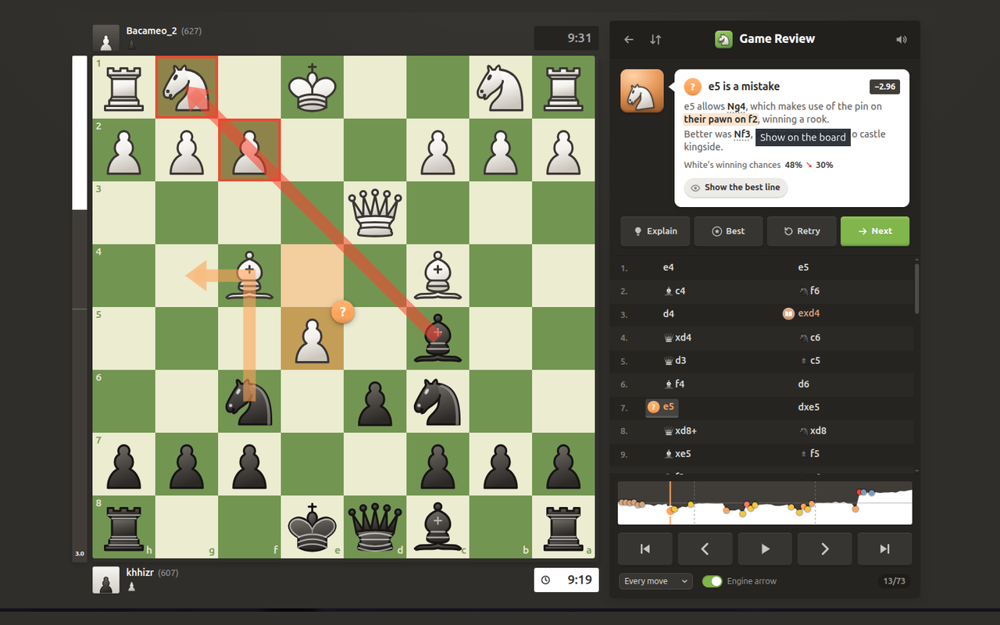
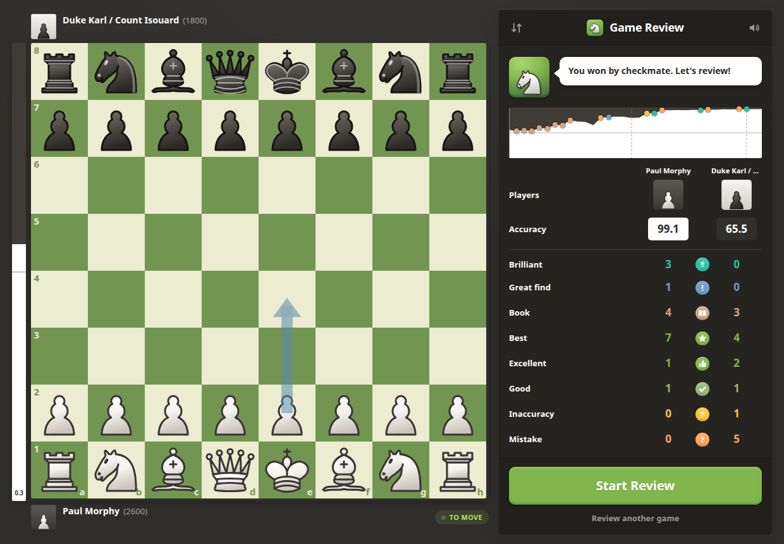
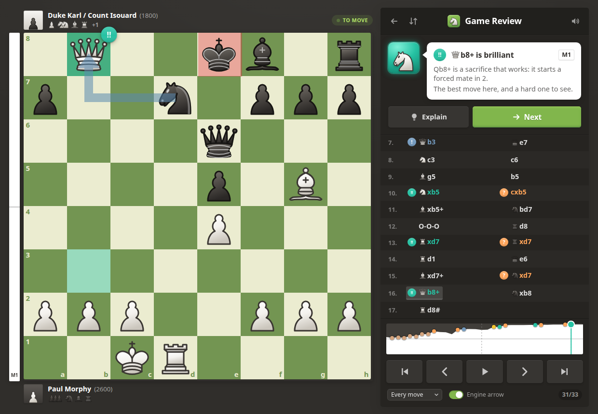
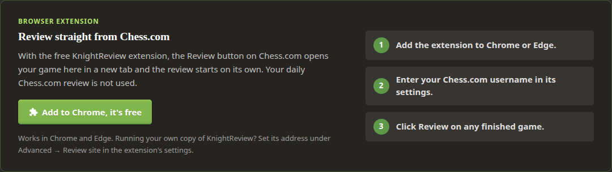

<div align="center">


# KnightReview

**Free, open-source chess game review with a coach that explains every move.**

No account. No daily limit. Works with Chess.com, Lichess and any PGN.

[**Try it now at knightreview.online**](https://knightreview.online/) ·
[Chrome extension](https://chromewebstore.google.com/detail/knightreview-free-chess-g/ofiloeeincplbpiokogjdjoekgngohco) ·
[Run it yourself](#run-it-yourself)

[](https://knightreview.online/)
[](https://chromewebstore.google.com/detail/knightreview-free-chess-g/ofiloeeincplbpiokogjdjoekgngohco)
[](LICENSE)
[](https://github.com/khhizr007/knightreview)



</div>

## What it does

Type your Chess.com or Lichess username, pick a game, and you get a full review:

- **Every move graded**, from Brilliant and Great down to Mistake, Miss and Blunder.
- **A coach that explains why** in plain words: the fork, the pin, the piece left hanging, the threat
  you missed. It shows the line that proves it.
- **Accuracy for each player** and for each phase of the game, an evaluation graph, and the moments
  that decided it.
- **Your own ideas count too.** Play any move on the board and it is graded and explained the same
  way, with a live Stockfish engine running in your browser.

<p align="center">
  
  
</p>

## What makes it different

- **Grades that fit the player.** A move is graded by how much of your winning chances it keeps,
  at your rating, not only by how many centipawns it lost. The same slip costs more in a won
  endgame than in a wild position.
- **A coach you can trust.** Before you see a note, a built-in fact checker reads it back and checks
  every claim about the board: the pieces it names, the moves, the material won, the forks and pins.
- **Honest about difficulty.** With [Maia-2](https://github.com/CSSLab/maia2), a model trained on
  millions of human games, the coach knows which moves players at your rating usually find. It says
  "hard to find at this level" instead of only calling your move bad.
- **Free and yours.** No account, no daily limit, open source under the GPL. Run your own copy with
  one Docker command. Finished reviews are deleted after a day.

## Chrome extension: review straight from Chess.com

With the [KnightReview extension](https://chromewebstore.google.com/detail/knightreview-free-chess-g/ofiloeeincplbpiokogjdjoekgngohco),
the **Review** button on Chess.com opens your game in KnightReview instead, and the review starts on
its own. Your daily Chess.com review is not used.

1. [Add the extension](https://chromewebstore.google.com/detail/knightreview-free-chess-g/ofiloeeincplbpiokogjdjoekgngohco)
   to Chrome or Edge.
2. In the settings page that opens, enter your Chess.com username and click **Save**.
3. Finish a game on Chess.com and click **Review**.

**Running your own copy?** Point the extension at it: open the extension's settings (click its icon
in the toolbar), expand **Advanced**, and set **Review site** to your address, for example
`http://localhost:8080/` or `https://chess.example.com/`. Click **Save**. Reviews now open on your
server instead of knightreview.online.



The extension's source is in [`extension/`](extension/README.md).

## Run it yourself

There are two ways to run KnightReview on your own computer:

- **[Option 1: Docker](#option-1-docker-easiest)** is the easiest. One command, everything included.
- **[Option 2: From source](#option-2-from-source)** is for when you want to change the code.

Both set up **Maia-2**, which is what lets the coach talk about how hard a move was to find. We
recommend keeping it on: the coach's explanations are noticeably better with it. Turn it off only if
your machine is short on memory (Maia needs about 400 MB of extra RAM).

### Option 1: Docker (easiest)

You need [Docker](https://docs.docker.com/get-docker/) (Docker Desktop on Windows and macOS) and
about 3 GB of free disk space. The image includes Stockfish 18 and Maia-2, so there is nothing else
to install.

**Step 1.** Download the code:

```bash
git clone https://github.com/khhizr007/knightreview.git
cd knightreview
```

**Step 2.** Build and start it:

```bash
docker compose up -d --build
```

The first build takes several minutes. Later starts take seconds.

**Step 3.** Open **http://localhost:8080** in your browser, enter a username, and review a game.

That's it. To stop it, run `docker compose down`. Your finished reviews are kept for a day.

<details>
<summary><b>Without Docker Compose</b></summary>

```bash
docker build -t knightreview .
docker run -d --name knightreview -p 127.0.0.1:8080:8080 knightreview
```

Stop it with `docker stop knightreview`.

</details>

<details>
<summary><b>Low on memory? Turn Maia off</b></summary>

Add `-e MAIA_COMMAND=` to `docker run`:

```bash
docker run -d --name knightreview -p 127.0.0.1:8080:8080 -e MAIA_COMMAND= knightreview
```

With Docker Compose, add `MAIA_COMMAND: ""` under `environment:` in `compose.yaml`. Reviews still
work; the coach just won't comment on how hard a move was to find.

</details>

<details>
<summary><b>Older CPU or slow reviews?</b></summary>

- If Stockfish crashes on start, your CPU may not support AVX2. Rebuild with
  `docker build --build-arg STOCKFISH_ARCH=x86-64 -t knightreview .`
- Each engine process uses about 370 MB of RAM. `ENGINE_POOL_SIZE` (2 in `compose.yaml`) sets how
  many run at once. Lower it on a small machine, raise it on a big one for faster reviews.

</details>

### Option 2: From source

These steps are for Linux and macOS. On Windows, run them inside
[WSL](https://learn.microsoft.com/windows/wsl/install).

**Step 1. Install the tools.**

| Tool | Version | How to get it |
|---|---|---|
| Git | any | [git-scm.com](https://git-scm.com/downloads) |
| Rust | 1.88 or newer | [rustup.rs](https://rustup.rs/) |
| Node.js | 20.19 or newer | [nodejs.org](https://nodejs.org/) |
| Stockfish | any recent | `sudo apt install stockfish` or `brew install stockfish` |
| uv (for Maia) | any | [docs.astral.sh/uv](https://docs.astral.sh/uv/getting-started/installation/) |

**Step 2. Download the code.**

```bash
git clone https://github.com/khhizr007/knightreview.git
cd knightreview
```

**Step 3. Install Maia-2.** This creates a separate Python 3.12 environment in `~/maia312`, so it
doesn't touch your system Python. uv downloads Python 3.12 for you if you don't have it.

```bash
uv venv --python 3.12 ~/maia312
uv pip install --python ~/maia312/bin/python torch==2.8.0 --index-url https://download.pytorch.org/whl/cpu
uv pip install --python ~/maia312/bin/python maia2==0.10.0 --extra-index-url https://download.pytorch.org/whl/cpu --index-strategy unsafe-best-match
```

Low on memory? Skip this step, and leave out the `MAIA_COMMAND` line in the next one.

**Step 4. Start the server** (from the `knightreview` folder):

```bash
cd backend
MAIA_COMMAND="$HOME/maia312/bin/python $PWD/../tools/maia/maia_sidecar.py --type rapid" \
  cargo run --release -p review-server
```

The first build takes a few minutes. On its first start, Maia downloads its model (280 MB). The
server is ready when you see:

```text
human-move model ready model=Maia-2 rapid
listening on http://127.0.0.1:8080
```

Leave this terminal open.

**Step 5. Start the website.** Open a **second terminal** in the `knightreview` folder:

```bash
cd frontend
npm install
npm run dev
```

**Step 6.** Open **http://localhost:5173** in your browser and review a game.

<details>
<summary><b>Troubleshooting</b></summary>

- **"Analysis servers unavailable" on the page:** the server didn't find Stockfish. Run
  `which stockfish` to get its path, then start the server with
  `STOCKFISH_PATH=/path/to/stockfish` added in front of `cargo run`.
- **No "human-move model ready" line:** check the Maia paths in `MAIA_COMMAND`. The folder path must
  not contain spaces. Reviews still work without Maia.
- **Port 5173 is in use:** run `npm run dev -- --port 5174` and open that port instead.

</details>

<details>
<summary><b>Run it as a single server</b></summary>

To serve the website and the API from one process (for example on a home server):

```bash
cd frontend && npm ci && npm run build
cd ../backend && cargo build --release -p review-server
STATIC_DIR=../frontend/dist \
MAIA_COMMAND="$HOME/maia312/bin/python $PWD/../tools/maia/maia_sidecar.py --type rapid" \
  ./target/release/review-server
```

Then open http://localhost:8080.

</details>

## Custom sounds

KnightReview makes its own move and review sounds, so it works without any audio files. To use your
own, add MP3 files with these names. Any file you leave out keeps the built-in sound.

| File | When it plays |
|---|---|
| `move.mp3`, `capture.mp3`, `castle.mp3`, `check.mp3`, `promote.mp3` | Moves on the board |
| `brilliant.mp3` | A Brilliant move |
| `correct.mp3`, `incorrect.mp3` | Retrying a missed move: found it, or not yet |
| `result_good.mp3`, `result_ok.mp3`, `result_bad.mp3` | Retrying a missed move: how good your answer was |

- **From source:** put the files in `frontend/public/sounds/` and reload the page. That folder is
  ignored by Git, so your sounds stay local.
- **With Docker:** keep the files in a folder and mount it into the container:

  ```bash
  docker run -d --name knightreview -p 127.0.0.1:8080:8080 \
    -v "$PWD/my-sounds:/app/static/sounds:ro" knightreview
  ```

  With Docker Compose, add `- ./my-sounds:/app/static/sounds:ro` under `volumes:` in `compose.yaml`.

Only use sounds you have the right to use.

## How it's built

- **Backend:** Rust. Every move is analysed with [Stockfish](https://stockfishchess.org/), then
  graded by a set of rules based on win chances and the players' ratings. The rules live in
  [`backend/crates/review-core`](backend/crates/review-core/src/config.rs).
- **Frontend:** React and TypeScript, with Lichess's [chessground](https://github.com/lichess-org/chessground)
  board and a WebAssembly Stockfish for the moves you try yourself.
- **Maia-2:** a small Python process the server talks to, in [`tools/maia`](tools/maia/maia_sidecar.py).

## Contributing

Bug reports and ideas are welcome in [Issues](https://github.com/khhizr007/knightreview/issues). If
KnightReview helped you, a ⭐ on GitHub helps other players find it.

## License

[GPL-3.0-or-later](LICENSE). Third-party components and their licenses are listed in
[`THIRD_PARTY.md`](THIRD_PARTY.md). KnightReview is an independent project and is not affiliated with
Chess.com or Lichess.
